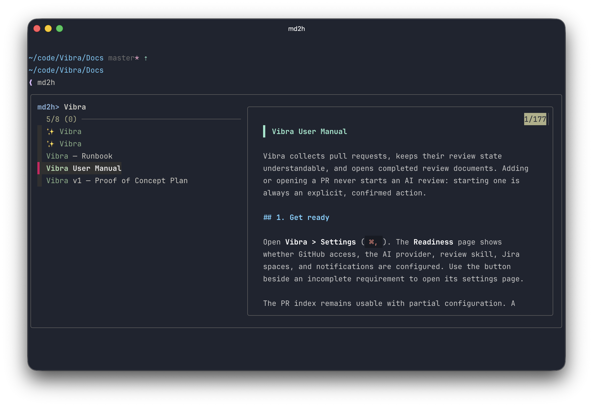
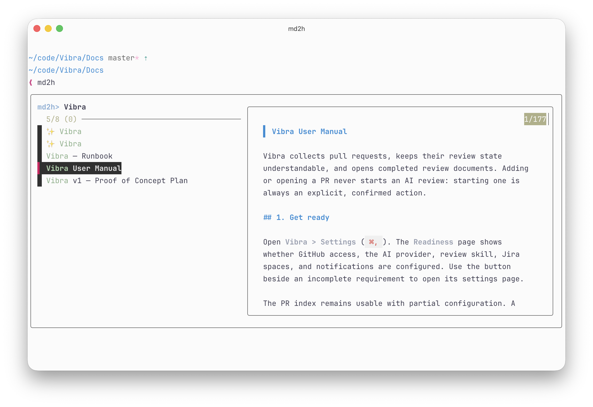
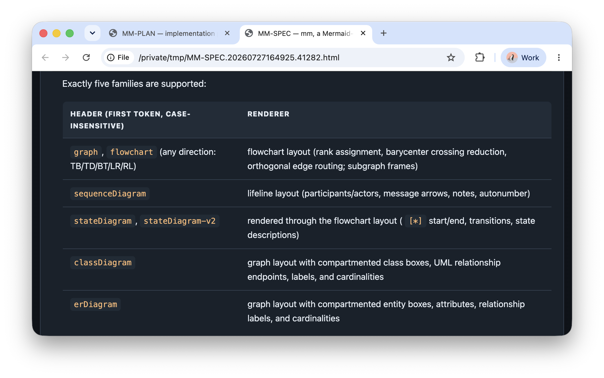
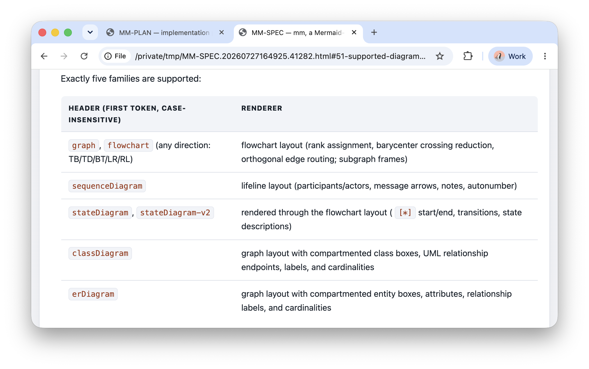
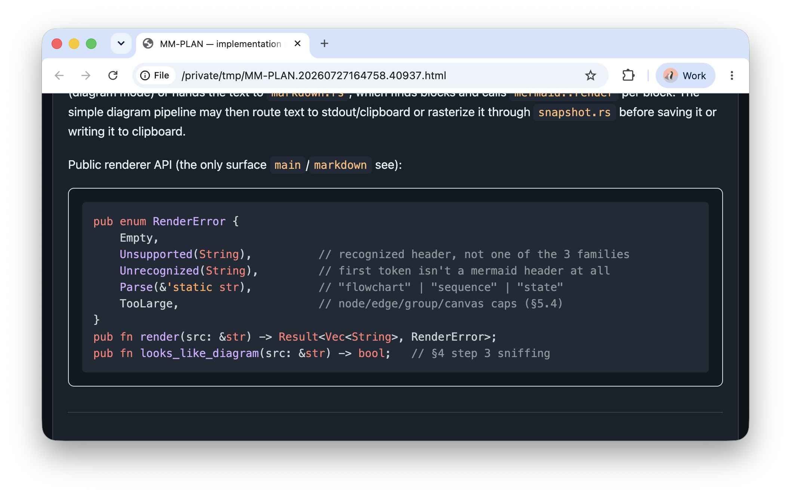
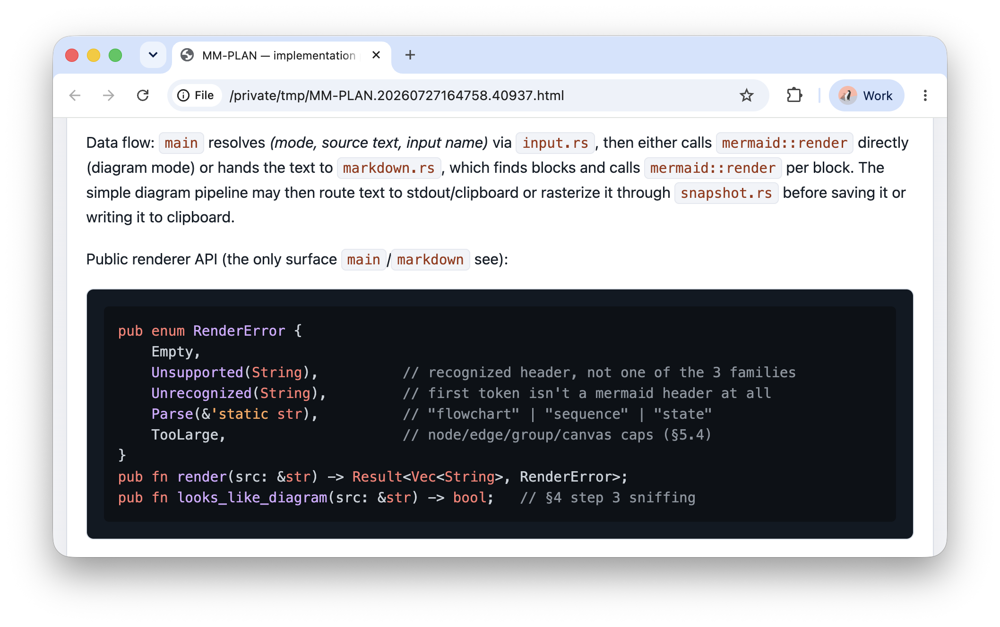
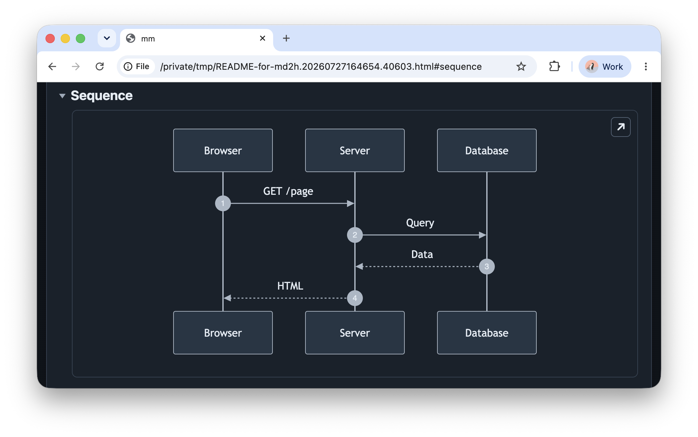
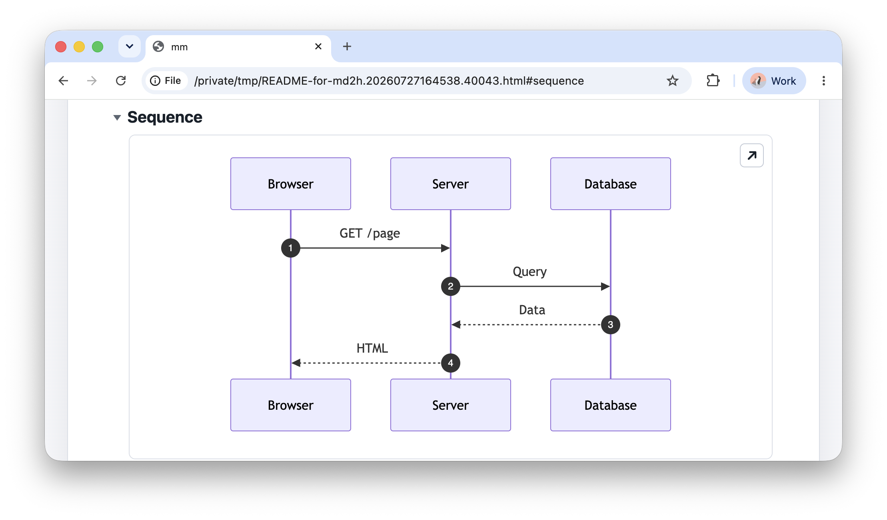
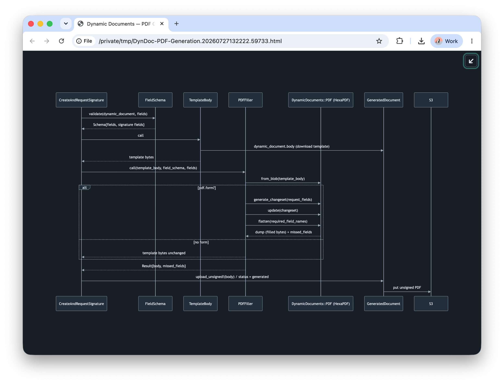
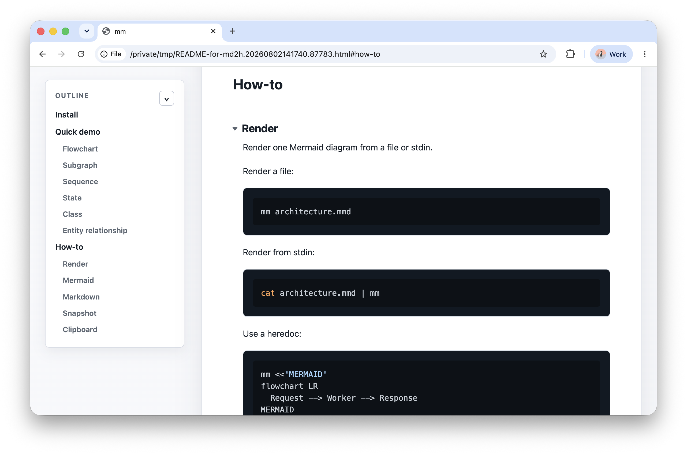

# `md2h`: Markdown to ~~HTML~~ Human

`md2h` converts Markdown files into standalone, styled HTML documents and opens the result in your browser. It includes support for common Markdown features, Mermaid diagrams, tables, task lists, front matter, and local images.

## Features
* Markdown to HTML conversion
* Picker (when invoked without arguments)
* Table of contents outline
* Styled tables, code blocks and quotes
* Images (with optional base64 embedding via `--embed-images`/`-e`)
* Linked Markdown collections with `--linked`
* Mermaid diagrams with zoom
* Image zoom on click
* Dark/Light Appearance
* Collapsed header levels 3+
* Expandable Markdown blocks with `expand` fences
* Full width view (when outline is hidden)
* Custom output path with `--option`/`-o`
* Full-screen slide decks with `--slides`

## Install

Requirements:
* [Node.js](https://nodejs.org/)

Optional dependencies:
* [fzf](https://github.com/junegunn/fzf) picker engine
* [glow](https://github.com/charmbracelet/glow) picker preview

Install the command and its preview themes:

```sh
make install
```

By default this installs `md2h` to `~/.local/bin`. Ensure that directory is on your `PATH`.

Optionally install the bundled team slide summary skill for Codex CLI:

```sh
make install-skills
```

`make install` does not install skills. `make install-skills` installs the bundled `md2h-team-slides` skill to `~/.agents/skills`, replacing any existing copy. Override the destination with `CODEX_SKILLS_DIR` if needed.

## Usage

Show concise authoring guidance for a slide deck:

```sh
md2h --howto slides
```

Convert and open a Markdown file:

```sh
md2h notes.md
```

Specify an output path and embed images as base64 data URLs:

```sh
md2h notes.md --option dist/notes.html --embed-images
```

Render an entry document and every local Markdown document it links to:

```sh
md2h docs/index.md --linked -o dist/index.html
```

Linked documents are discovered transitively within the entry document's directory and its subdirectories. Links can include the `.md` extension or omit it, as in `[Guide](guides/start)`. The generated HTML preserves that directory structure, rewrites Markdown links to their HTML counterparts, and safely handles circular links. External URLs, absolute paths, missing files, and links that resolve outside the entry directory are not followed. Without `-o`, the collection is written to a temporary directory. Only the entry document is opened in the browser.

### Technical identifiers

Identifiers with internal underscores, such as raw_employee_payment_breakdown.payload.output,
external_refunds, and ES::ConceptType.after_tax, automatically render as inline code.
Intentional `_italic_` and `__bold__` formatting still works. Link destinations,
image URLs, and existing code spans retain their original content. Use backticks
to explicitly format other technical terms as code.

### Expandable content

Use an `expand` code fence for an expandable block. The first line is its title; the remaining lines render as Markdown. Blocks start collapsed and show a chevron pointing right when collapsed and down when expanded. The tinted background follows the light or dark appearance, including while collapsed.

````markdown
```expand
The title goes here

This is the content, with **formatting**.

- A list item
```
````

Click the title or focus it and press Enter or Space to expand or collapse the block. Expandable blocks also work in slide decks.

### Slide decks

Use `--slides` to render a full-screen presentation. Each level-1 heading starts a main slide:

```sh
md2h talk.md --slides
```

The option can be combined with a custom output path and embedded images:

```sh
md2h talk.md --slides -o dist/talk.html
md2h talk.md --slides -o dist/talk.html --embed-images
```

You can also invoke the converter directly:

```sh
node markdown-to-html.js talk.md dist/talk.html --slides
```

#### Deck structure

- A level-1 heading such as `# Architecture` starts a new main slide and supplies its title.
- Use `#` or `# ---` to start a slide without displaying a title.
- A title-less slide containing only one or two lines of text becomes a large, centered cover slide. Cover slides can appear anywhere in the deck.
- Text-only slides (including bullet lists) automatically enlarge their text to fit the available width and height without scrolling, and recalculate when the window is resized. Slides with images, diagrams, tables, or code blocks keep their existing layout.
- A vertical stack shows bottom-centered navigation chevrons: large and animated on its main slide, then smaller and activity-sensitive on its subslides.
- A thematic break (`---`) inside a main slide starts a vertical subslide. Front-matter delimiters and `# ---` slide delimiters are treated separately.

```markdown
# Slide title

First subslide

---

## Subslide title

Second subslide

---

Third subslide
```

#### Slide features

- Slides fill the browser viewport. A slide scrolls vertically when its content is taller than the available space.
- Tables, images, syntax-highlighted code, task lists, quotes, and Mermaid diagrams use the same rendering as regular documents.
- A slide containing only an image or Mermaid diagram, with an optional title, automatically gives the media the remaining viewport height.
- Images and diagrams can be expanded with their top-right control, by clicking an image, or with `Z`.
- Vertical slide stacks display their position in the bottom-right navigator and are marked in the slide picker.
- The visual slide picker provides miniature previews and title search.
- The URL hash tracks the current main slide and subslide, allowing direct links such as `#md2h-slide-3-2`.
- Browser printing places every slide on a separate page and hides presentation controls.
- Inter and Roboto Mono are loaded from Google Fonts for consistent typography, with local fallbacks when the fonts cannot be downloaded.

#### Presentation keys

| Key | Action |
|---|---|
| `Space`, `Right Arrow`, or `l` | Open the next main slide |
| `Left Arrow` or `h` | Open the previous main slide |
| `Down Arrow` or `j` | Open the next vertical subslide |
| `Up Arrow` or `k` | Open the previous vertical subslide |
| `z` | Expand or restore the current image or diagram |
| `Escape` | Restore expanded media, close the picker, or open the picker |

The bottom-right controls provide previous-slide, slide-picker, and next-slide actions.

#### Slide picker keys

| Key | Action |
|---|---|
| `Space`, `Right Arrow`, or `l` | Select the next preview |
| `Left Arrow` or `h` | Select the previous preview |
| `Down Arrow` or `j` | Select the preview in the next row |
| `Up Arrow` or `k` | Select the preview in the previous row |
| `Enter` | Open the selected slide |
| `/`, `Command-F`, or `Ctrl-F` | Search slide titles |
| `Escape` | Clear an active search or close the picker |

When a search has one match, `Enter` opens that slide. With multiple matches, `Enter` returns focus to preview navigation.

#### Slide appearance

Configure the color appearance and Highlight.js code theme in front matter:

```markdown
---
appearance: dark
theme: atom-one-dark
---

# Opening slide
```

`appearance` accepts `light` or `dark`. `theme` accepts a Highlight.js theme name such as `github`, `github-dark`, `atom-one-dark`, or `a11y-light`. Without `appearance`, the deck follows the system preference. Without `theme`, it uses `github` for an explicitly light deck and `github-dark` otherwise.

Run `md2h` with no arguments to select a Markdown file interactively. The picker requires `fzf`; installing `glow` adds rendered Markdown previews.

You can also invoke the converter directly and choose the output path:

```sh
node markdown-to-html.js notes.md dist/notes.html
```

## Screenshots

Interactive terminal picker in dark and light modes:

| Dark | Light |
|------|-------|
| [](assets/terminal-dark.png) | [](assets/terminal-light.png) |

Rendered HTML supports tables (dark/light), code blocks, and Mermaid diagrams:

| Tables dark | Tables light |
|-------------|--------------|
| [](assets/tables-dark.png) | [](assets/tables-light.png) |

| Source code dark | Source code light |
|------------------|-------------------|
| [](assets/source-code-dark.png) | [](assets/source-code-light.png) |

Mermaid diagrams with dark/light themes and full-width view:

| Diagram dark | Diagram light |
|--------------|---------------|
| [](assets/diagram-dark.png) | [](assets/diagram-light.png) |

| Diagram full view | Full width - no outline |
|-------------------|-------------------------|
| [](assets/diagram-full-view.png) | [](assets/outline.png) |
